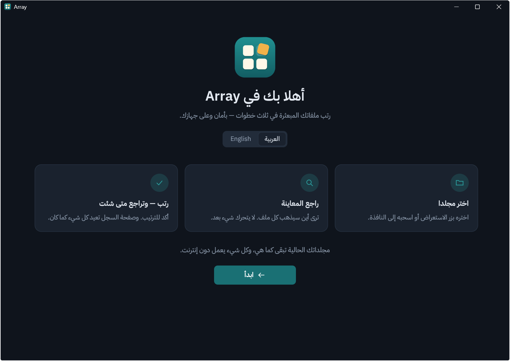
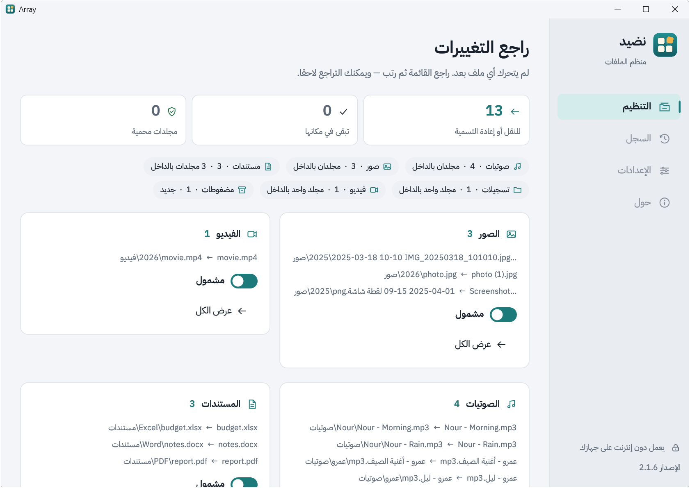
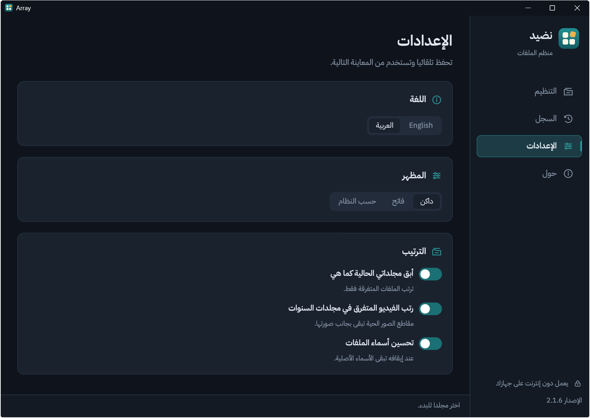
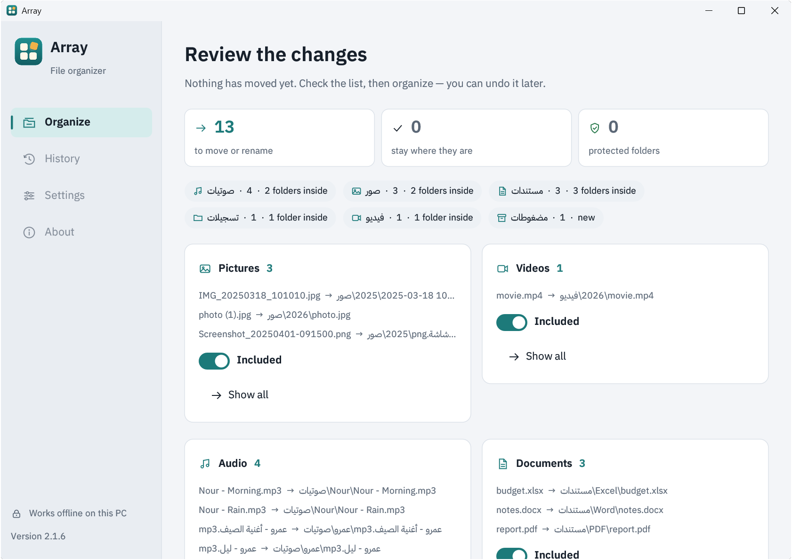

<div dir="rtl">

<p align="center">
  
</p>

<p align="center">
  
  
  
  
  
</p>

<h1 align="center">Array — منظّم الملفات</h1>

<p align="center">
  برنامج لويندوز يجمع ملفاتك المبعثرة ويرتّبها في مجلدات واضحة:<br>
  الصور والفيديو حسب السنة، والتلاوات والأغاني في مجلد كل قارئ وفنان —<br>
  <b>دون إنترنت، ودون أن يتحرك أي ملف قبل موافقتك، مع إمكانية التراجع.</b>
</p>

<p align="center">
  <a href="https://github.com/alimwork85-web/Array/releases/latest/download/Array-2.2.0.exe"><b>⬇ تنزيل Array 2.2.0 لويندوز</b></a>
  &nbsp;·&nbsp;
  <a href="https://github.com/alimwork85-web/Array/releases">كل الإصدارات</a>
  &nbsp;·&nbsp;
  <a href="#english">English</a>
</p>

<p align="center">
  
</p>

## لماذا Array؟

مجلد التنزيلات، ومجلد الصور المنقولة من الجوال، ومجلد المقاطع الصوتية… تتراكم فيها آلاف الملفات بأسماء مثل `IMG_2353.MP4` و`4749d951].mp3` و`صوت (1) (2).mp3`. ترتيبها يدوياً يأخذ أياماً. Array يقوم بذلك في دقائق، وبحذر:

- **يعرض عليك كل شيء أولاً.** ترى في جدول أين سيذهب كل ملف واسمه الجديد، ولا يتحرك شيء حتى تضغط «رتّب».
- **التراجع متاح دائماً.** زر واحد في صفحة «السجل» يعيد كل ملف إلى مكانه واسمه الأصليين.
- **لا يمس ما رتّبته أنت.** مجلداتك الموجودة تبقى كما هي افتراضياً، ويُرتَّب فقط ما هو متفرق.
- **لا يكسر برامجك.** مجلدات البرامج والمشاريع البرمجية والسكريبتات ومجلدات ويندوز تُتخطّى بالكامل.
- **خصوصيتك محفوظة.** كل شيء يعمل على جهازك. لا يُرفع أي ملف ولا يحتاج حساباً.

## أبرز المميزات

| | |
|---|---|
| 🗂️ **ترتيب حسب النوع** | صور، موسيقى وصوتيات، فيديو، مستندات، ملفات مضغوطة. ويستخدم مجلداتك الموجودة إن وُجدت بالعربية أو الإنجليزية («صور»، «Pictures»…). |
| 🎬 **الفيديو حسب السنة** | سنة التصوير من اسم المقطع أو من بيانات الفيديو نفسه، ومقاطع «الصور الحية» من الآيفون تبقى بجانب صورتها. |
| 🎧 **التلاوات والأغاني حسب القارئ والفنان** | يجمع المقاطع بعدة أدلة معاً: الوسوم، واسم الملف، والحلقات («الحلقة 3 - الشيخ فلان»)، والألبوم… ولا يُنشئ مجلداً لملف واحد؛ المقاطع المنفردة تذهب إلى «منوعات»، ومقاطع الذكاء الاصطناعي في مجلد خاص بها. |
| ✏️ **أسماء أوضح** | يحذف الأكواد مثل `[AUD-…]` و`(1)`، ويصلح النص العربي المشوّه، ويعطي الملفات ذات الأسماء العشوائية اسماً من سياقها وتاريخها. يمكن إيقافه لتبقى الأسماء كما هي. |
| 🌐 **عربي وإنجليزي** | واجهة كاملة من اليمين لليسار بالعربية، أو بالإنجليزية، والتبديل من الإعدادات. الأرقام دائماً 0-9. |
| 🌓 **فاتح وداكن** | يتبع سمة ويندوز أو اختيارك. |

<p align="center">
  
</p>

## طريقة الاستخدام

1. **اختر مجلداً**: بزر «استعراض» أو بسحبه إلى النافذة.
2. **راجع المعاينة**: ترى عدد الملفات، والمجلدات التي ستُنشأ، والمجلدات المحمية، وجدولاً بكل ملف ومكانه الجديد.
3. **رتّب**: وإن لم تعجبك النتيجة، افتح «السجل» واضغط «تراجع عن آخر ترتيب».

<p align="center">
  
</p>

## التنزيل والتشغيل

- **المتطلبات:** ويندوز 10 أو 11 (64 بت). لا يحتاج إنترنت ولا تثبيت أي شيء آخر.
- **التشغيل:** نزّل [`Array-2.2.0.exe`](https://github.com/alimwork85-web/Array/releases/latest/download/Array-2.2.0.exe) (حوالي 12 MB) وشغّله مباشرة. يمكنك وضعه في أي مجلد وعمل اختصار له.
- **تحذير ويندوز (SmartScreen):** قد يظهر عند أول تشغيل لأن الملف غير موقّع رقمياً. اختر «مزيد من المعلومات» ثم «تشغيل على أي حال».
- **الإعدادات وسجل التراجع** تُحفظ في `%APPDATA%\Array`. لإزالة البرنامج احذف ملف `exe` وهذا المجلد.

## أسئلة شائعة

<details>
<summary><b>هل يحذف البرنامج أي ملف؟</b></summary>

لا. البرنامج **ينقل ويعيد تسمية** فقط، ولا يكتب فوق ملف موجود أبداً (إذا تشابه اسمان يضيف رقماً). المجلدات الوحيدة التي قد يحذفها هي المجلدات التي أفرغها هو بنفسه أثناء الترتيب، والتراجع يعيدها.
</details>

<details>
<summary><b>هل يتصل البرنامج بالإنترنت؟</b></summary>

لا. البرنامج لا يتصل بالإنترنت إطلاقاً ولا يرفع أي ملف؛ كل العمل يجري على جهازك.
</details>

<details>
<summary><b>ماذا لو اخترت مجلد برنامج أو مشروع بالخطأ؟</b></summary>

يرفض البرنامج ترتيبه ويخبرك بالسبب. وأي مجلد برنامج أو مشروع (فيه `exe` أو `package.json` أو `.git` أو سكريبتات…) داخل المجلد الذي اخترته يُترك كما هو بكل ما فيه، ويظهر في المعاينة تحت «مجلدات محمية». كذلك لا يقبل جذر القرص ولا مجلدات ويندوز وProgram Files.
</details>

<details>
<summary><b>هل يمكن تعديل الكلمات التي يتعرف بها على القرّاء والفنانين؟</b></summary>

نعم، من الإعدادات ← «تعديل القوائم في Notepad»: كلمات مثل «الشيخ» و«دكتور»، وأسماء أدوات الموسيقى بالذكاء الاصطناعي.
</details>

## البناء من المصدر

البرنامج مكتوب بلغة Rust وواجهته بمكتبة [egui](https://github.com/emilk/egui).

```bash
git clone https://github.com/alimwork85-web/Array.git
cd Array/array
cargo build --release
cargo test
```

الملف الناتج: `array/target/release/Array.exe`.

## المطوّر

**Ali Alhumedi** — تطوير ونشر Array. © 2026 Ali Alhumedi.

## الترخيص

الكود مرخّص برخصة [MIT](LICENSE).

</div>

---

<a id="english"></a>

## English

<p align="center">
  <b>Array</b> is a Windows app that gathers scattered files and sorts them into tidy folders:<br>
  photos and videos by year, recitations and songs into each artist's folder —<br>
  <b>offline, with nothing moved until you confirm, and one-click undo.</b>
</p>

<p align="center">
  <a href="https://github.com/alimwork85-web/Array/releases/latest/download/Array-2.2.0.exe"><b>⬇ Download Array 2.2.0 for Windows</b></a>
  &nbsp;·&nbsp;
  <a href="https://github.com/alimwork85-web/Array/releases">All releases</a>
</p>

<p align="center">
  
</p>

### Why Array?

Downloads, photos copied from your phone, audio collections… they pile up with thousands of files named `IMG_2353.MP4`, `4749d951].mp3` or `voice (1) (2).mp3`. Sorting them by hand takes days. Array does it in minutes — carefully:

- **Shows you everything first.** A table lists where every file will go and its new name. Nothing moves until you press *Organize*.
- **Undo is always there.** One button on the *History* page puts every file back with its original name.
- **Leaves what you organized alone.** Your existing folders stay as they are by default; only loose files are sorted.
- **Won't break your programs.** Program folders, coding projects, scripts and Windows folders are skipped entirely.
- **Private.** Everything runs on your PC. No uploads, no account.

### Features

| | |
|---|---|
| 🗂️ **Sort by type** | Photos, music & audio, videos, documents, archives. Reuses your existing folders whether they are named in Arabic or English ("Pictures", "صور"…). |
| 🎬 **Videos by year** | The year comes from the file name or the video's own creation date; iPhone Live Photo videos stay next to their photo. |
| 🎧 **Recitations & songs by reciter/artist** | Groups tracks using several clues together: tags, file name, episodes ("Episode 3 - Sheikh X"), album… Never creates a folder for a single file: singles go to a misc folder, AI-generated music to its own folder. |
| ✏️ **Cleaner names** | Removes codes like `[AUD-…]` and `(1)`, fixes garbled Arabic text, and gives random names a name from their context and date. Can be turned off to keep names as they are. |
| 🌐 **Arabic & English** | Full right-to-left Arabic interface or English, switchable in Settings. Numbers always use 0-9. |
| 🌓 **Light & dark** | Follows the Windows theme or your choice. |

### How to use

1. **Choose a folder** with *Browse* or by dragging it onto the window.
2. **Review the preview**: file counts, folders to be created, protected folders, and a table of every file and its new place.
3. **Organize** — and if you don't like the result, open *History* and press *Undo last organize*.

### Download & run

- **Requirements:** Windows 10 or 11 (64-bit). No internet and nothing else to install.
- **Run:** download [`Array-2.2.0.exe`](https://github.com/alimwork85-web/Array/releases/latest/download/Array-2.2.0.exe) (about 12 MB) and run it directly — it is portable; put it in any folder and make a shortcut.
- **Windows SmartScreen** may warn on first run because the file is not code-signed. Choose *More info* → *Run anyway*.
- **Settings and the undo record** are stored in `%APPDATA%\Array`. To remove the app, delete the `.exe` and that folder.

### FAQ

<details>
<summary><b>Does it delete any files?</b></summary>

No. Array only **moves and renames**, and never overwrites an existing file (if two names collide it adds a number). The only folders it may remove are the ones it emptied itself while organizing, and undo brings them back.
</details>

<details>
<summary><b>Does it connect to the internet?</b></summary>

No. Array never connects to the internet and never uploads anything; all the work happens on your PC.
</details>

<details>
<summary><b>What if I pick a program or project folder by mistake?</b></summary>

Array refuses to organize it and tells you why. Any program or project folder (with an `exe`, `package.json`, `.git`, scripts…) inside the folder you chose is left exactly as it is and listed under *protected folders* in the preview. Drive roots, Windows and Program Files are refused as well.
</details>

<details>
<summary><b>Can I edit the words used to recognize reciters and artists?</b></summary>

Yes: Settings → *Edit lists in Notepad* — words like "Sheikh" or "Dr." and names of AI music tools.
</details>

### Build from source

Written in Rust with an [egui](https://github.com/emilk/egui) interface.

```bash
git clone https://github.com/alimwork85-web/Array.git
cd Array/array
cargo build --release
cargo test
```

The result is `array/target/release/Array.exe`.

### Developer

**Ali Alhumedi** — developer and publisher of Array.

### License

The code is licensed under [MIT](LICENSE).
